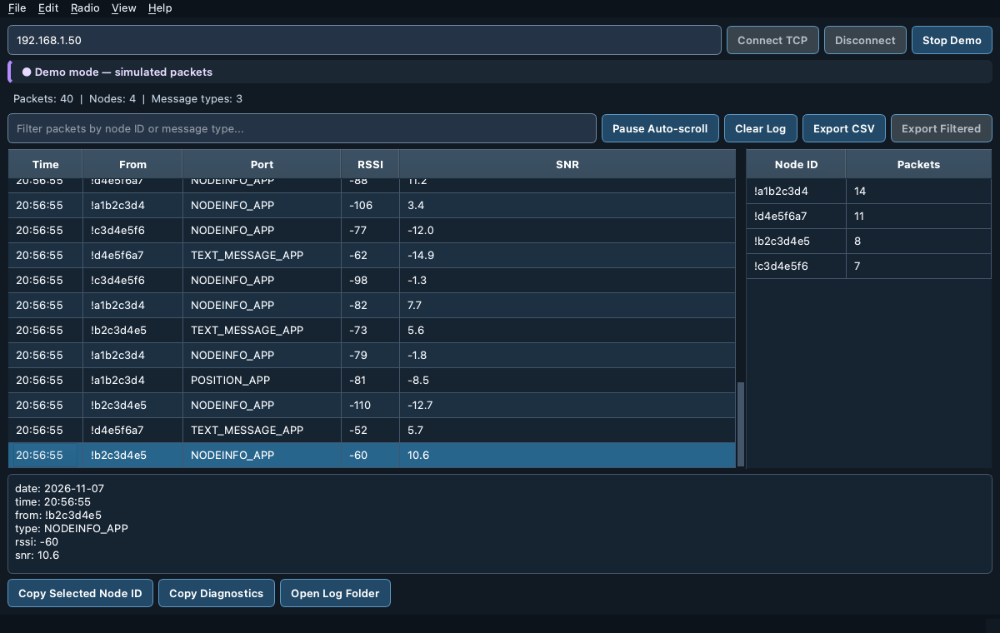
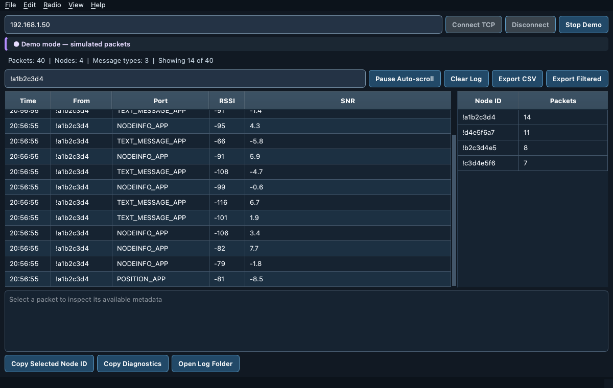

# Meshtastic Sniffer TCP

**A receive-focused Meshtastic packet monitor for Intel Macs.** Connect to a Meshtastic radio over your local network (Wi-Fi/TCP), inspect packets and node activity, and export logs. Independent community software; not affiliated with the Meshtastic project.

> **Scope:** This is not an SDR or over-the-air LoRa sniffer. It can only display packet information exposed by the connected Meshtastic radio. Encrypted content is not automatically decrypted.

## Features

- Live packet table with timestamp, source node, message type, RSSI and SNR (when reported)
- Search/filter packets by node ID or message type
- Packet totals, unique-node count and message-type statistics
- CSV export of the whole log or just the filtered rows: dated rows, timestamped file names, last folder remembered, spreadsheet-formula cells neutralised, and a failed export never leaves a half-written file
- Clear Log asks before discarding packets
- Demo mode for exploring the interface without radio hardware
- Remembered radio IP/hostname between app launches
- Detect dropped TCP sessions and reconnect automatically with bounded backoff (up to 5 attempts); manual disconnect cancels retries
- Session health line (uptime, packets this session, time since last packet, reconnects, last drop)
- **Copy Diagnostics** for bug reports and a rotating log file (`~/Library/Logs/Meshtastic Sniffer TCP/app.log`, opened with **Open Log Folder**)
- Dark, high-contrast desktop styling with a colour-coded connection status (connected, connecting, retrying, failed, demo); buttons enable only when they can act
- Menu bar with keyboard shortcuts (below); short confirmations appear in the status bar without hiding the connection state

**Known limitation:** Dropped-session detection and reconnect are tested with simulated interfaces only. Real-radio and Intel Mac hands-on verification are still required.

## Screenshots

Real renderings of the app in **demo mode** (simulated packets, not live radio traffic), captured offscreen with `python scripts/capture_screenshot.py`:





These come from Qt's offscreen renderer, so fonts and window chrome differ slightly from the app on macOS. The [screenshot workflow](.github/workflows/screenshots.yml) (**Actions → UI screenshots → Run workflow**) produces the same images on a GitHub-hosted Intel Mac.

## Keyboard shortcuts

| Action | Shortcut |
| --- | --- |
| Focus the packet filter | ⌘F |
| Connect / Disconnect | ⌘K / ⇧⌘D |
| Export CSV / Export filtered CSV | ⌘E / ⇧⌘E |
| Pause auto-scroll | ⇧⌘P |
| Clear log (asks first) | ⇧⌘K |

Pressing Return in the address field also connects.

## Download and run on an Intel Mac

1. Open [GitHub Actions](../../actions/workflows/intel-mac.yml) and select a successful **Intel Mac app build**.
2. Download the **Meshtastic-Sniffer-TCP-Intel** artifact and extract it.
3. Open the DMG and drag **Meshtastic Sniffer TCP.app** to **Applications**. The build is not signed with a Developer ID or notarized, so macOS may require **Control-click → Open** and approval in **System Settings → Privacy & Security**.
4. Enter the radio's reachable LAN IP address and select **Connect TCP**, or select **Demo Mode** to inspect simulated traffic. On macOS 15 or later, allow **Local Network** access when asked; if you declined, turn it on in **System Settings → Privacy & Security → Local Network**.

GitHub Actions packaging success is not proof that the app connects to a physical radio. No official release is published by these workflows.

## Connect your radio

The Mac and Meshtastic radio must be able to reach each other on the network. Meshtastic TCP normally uses port **4403**. Check the address and network if connection fails. See [TCP troubleshooting](docs/CONNECTION.md).

## Run from source

Python 3.11+ is recommended.

```bash
python3 -m venv .venv
source .venv/bin/activate
python -m pip install -r requirements.txt
python app.py
```

## Testing

GitHub Actions runs Python syntax and smoke tests and packages an Intel Mac app. To run tests locally with the required dependencies installed:

```bash
python -m unittest discover -s tests -v
```

Tests run Qt offscreen and keep their preferences in a temporary file, so they never change the radio address saved by the installed app.

## Privacy and safety

The app does not intentionally transmit messages. Packet logs and CSV exports may contain node identifiers or other sensitive metadata: handle and share them responsibly. Only monitor radios and networks you are authorized to access.

## Project status

**Active development / pre-release.** Planned work includes macOS packaging and release metadata, richer node activity views, and physical Intel Mac/radio testing (including dropped-session recovery on real hardware).
